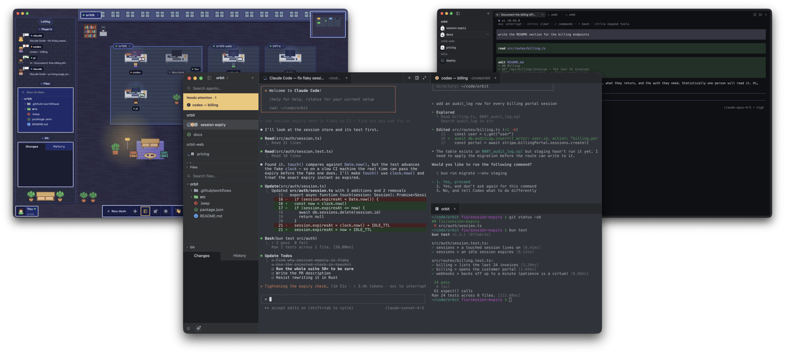

<p align="center">
  
</p>

<h1 align="center">pumi</h1>

<p align="center">
  <a href="https://pumi.dev">Website</a> ·
  <a href="https://pumi.dev/docs/">Docs</a> ·
  <a href="https://pumi.dev/plugins/">Plugins</a> ·
  <a href="https://discord.gg/p8RYkZU86">Discord</a>
</p>



pumi is a minimal, highly extensible workspace for agents that you can make your own.

Run Claude Code, Codex, pi and your other agents side by side; see which are working, blocked or
done; and tell them things without typing into their terminals. A server, `pumid`, owns the
terminals, so they keep running when the window closes.

Bend pumi to your workflow, not the other way around. Everything you see is drawn by plugins —
TypeScript on Bun, React in the window — and the plugins pumi ships with can be turned off or
replaced, down to the terminal renderer. A theme can restyle the whole window or redraw any part of
it. Share plugins and themes on GitHub; `pumi plugin add owner/repo` installs one.

pumi's core is small on purpose: tabs, terminals, agents, options, keys and a plugin loader. It
skips remote machines, automations, a git panel, a file browser and keymap presets. Build what you
want with the same API pumi uses, from a plugin or from any shell with the `pumi` command.

## Install

macOS and Linux:

```sh
curl -fsSL https://pumi.dev/install.sh | sh
```

Windows, in PowerShell:

```powershell
irm https://pumi.dev/install.ps1 | iex
```

Or unpack an archive from [GitHub releases](https://github.com/pumi-dev/pumi/releases). Needs
macOS 14+, Linux with glibc 2.35+, or Windows 10 1809+.

## Quickstart

`pumi` is on the `PATH` of every tab.

```sh
pumi tab open terminal --split right -- claude   # an agent beside this tab
pumi skill add                                   # status hooks for every agent on PATH
pumi agent queue %3 'run the tests again'        # delivered when its turn ends
pumi plugin new hello && pumi plugin dev hello   # your own plugin, reloaded on save
pumi plugin new mytheme --theme default          # your own theme, from the default's
pumi help                                        # every command
```

## Docs

- [How it fits together](docs/user/index.md)
- [Command line](docs/user/cli.md)
- [Plugins](docs/user/plugins.md)
- [Themes](docs/user/themes.md)
- [Contributing](CONTRIBUTING.md)
- [Security](SECURITY.md)

Plugins and themes run with your permissions and are not sandboxed; install what you would run as
code. If one breaks the window, start with `--safe` (`open -a pumi --args --safe` on macOS).

## Build from source

Rust (pinned in `rust-toolchain.toml`), Zig 0.16.0 and Bun; plus the Xcode command line tools on
macOS, `scripts/release/linux-deps.sh` on Debian/Ubuntu, or the MSVC build tools on Windows.

```sh
git clone https://github.com/pumi-dev/pumi && cd pumi
(cd runtime/app && bun install)      # the app's JS dependencies, first
./scripts/install.sh                 # macOS: build and install pumi.app
scripts/release/build.sh             # any OS: a release build for this machine
```

Before changing code, read [Plugins](docs/user/plugins.md): the app, the CLI and plugins share that
API. [Contributing](CONTRIBUTING.md) has the dev build, the tests and the checks CI runs.

## License

The server and the crates to build on it (`pumid`, the `pumi` command line, `pumi-proto`,
`pumi-api`, `pumi-api-macros`, `pumi-sys`, `pumi-layout`, `pumi-model`) and the renderer,
`pumi-gpuix`, with its protocol, `pumi-ui-proto`, are [Apache-2.0](LICENSE-APACHE). The app, its plugins and the rest are
[GPL-3.0-or-later](LICENSE). Third-party notices are in [NOTICE](NOTICE).
