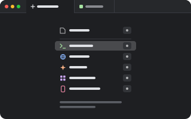

# Launchpad

<p align="center"></p>

A tab that lists what you can open in it: the same list as the `+` menu (Terminal's shell, each
agent, Browser's page, …), the most used first, each with a key to press. What you pick takes the
tab's place, in the same pane. A last row, **Explore plugins**, opens the plugins in Settings.

Launchpad ships with pumi (`runtime/bundled/launchpad`): it is installed already, it is not in the
start screen's list or the store, and it is what new tabs open. `pumi plugin update
pumi/launchpad {enabled: false}` turns it off; it is never removed.

## New tabs

`new_tab` names Launchpad's block (`pumi.launchpad.new`) and every new tab, split, view and
session starts as the list. While `new_tab` names nothing installed, new tabs open it all the
same: it is the first of what pumi prefers, before a shell.

## Keys

The keys are drawn only while the tab has the focus.

| Key | |
| --- | --- |
| a row's letter | that row: the same letter as in the `+` menu (`C` Claude Code, `P` Pi, `T` Terminal…), which stays as the order changes |
| `↑` `↓`, `Enter` | choose one, open it: the last row opens the plugins in Settings |
| `Escape` | close the tab |

On a pumi before `useNewTabs`, the list is the `tab.new` slot's actions, in order, on `1` … `9`.

## The block

`pumi.launchpad.new` takes no arguments. `src/ui.tsx` draws it with the `+` menu's list
(`useNewTabs` from `pumi/theme`), less its own row, then the row that opens the plugins in
Settings (`openSettings("store")`); `src/kinds.ts` is what the list holds, apart from drawing it.

## Testing

```sh
bun test && bunx tsc --noEmit
```
